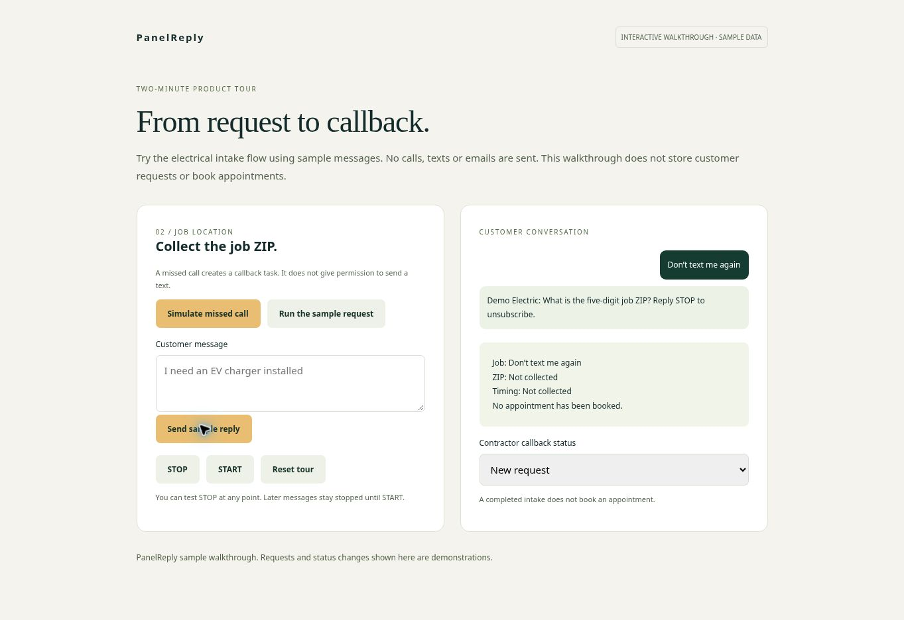

# PanelReply browser retest — November 18, 2026

Starting branch commit: `bbe9cd02c9f186933b26450fea0db5f37c643817`.
Live Render commit at inspection: `100030c7976f60dba483510a233cdc8ce95d5097`.

## Confirmed findings

| Priority | Reproduction | Observed before correction | Correction |
| --- | --- | --- | --- |
| Medium | Reset, submit `Don’t text me again` using a curly apostrophe. Also test `Please stop texting me, please.`. | Opt-out intent could become a job description and trigger a ZIP prompt. | Normalize punctuation and whitespace only for intent matching, preserving the displayed message. |
| High | Submit `My breaker` followed by a newline and `is melting`, including at ZIP stage and after STOP. | The prior branch matcher missed the hazard. | Collapse whitespace for hazard matching. Keep STOP suppression and safety hold separate. |
| High | Submit `The power line is down in my yard`. | The prior branch matcher missed the auxiliary word `is`. | Accept ordinary `is`, `are`, `has` and `have` wording in the existing power-line rule. |
| Medium | Submit a 500-character unbroken job description. | Live Chromium page width grew to 4101 pixels in a 1363-pixel viewport. | Wrap long summary content and recompute the stylesheet CSP hash. |

The original live demo visibly reproduced the curly-apostrophe opt-out, multiline-hazard and long-summary failures. The branch's JavaScript reproductions were repeated before correction. Six focused Node regression tests were added. They initially reported 30 PASS / 5 FAIL, then 35 PASS / 0 FAIL after the corrections.

## Verified result

- PASS: 35 Node unit tests, including exact script/style CSP checks, in both the local snapshot and GitHub Actions.
- PASS: 11 real Chromium browser scenarios, with zero failures, in GitHub Actions.
- PASS: three fresh live Render GET smoke checks for availability/disclosure, robots.txt and served CSP integrity.
- FAIL: the deployed demo's observed opt-out, hazard and long-summary behavior. Draft fixes are not deployed.

Evidence: [GitHub Actions run 44428006237](https://github.com/panelreply-business/panelreply-demo/actions/runs/44428006237), commit `097f6f8a032be59b2dfb3dc15a225d29056e1557`, completed successfully at 7:19 p.m. Eastern on November 18. Logs report 38 Node tests passed, zero failed or skipped, and 11 Chromium tests passed. Chromium version: `151.0.7922.34`. The app, browser test and workflow contents fetched from that commit exactly matched the tested local snapshot. This later report update changes documentation only.

The browser suite uses a local HTTP copy of the two files published by Render, real Chromium controls, and viewport widths of 320, 390, 768 and 1280 pixels. It checks keyboard traversal, form validation, full intake, opt-outs, safety holds, reset, text injection and absence of storage. External browser requests are blocked and fail the test. This is not a real phone/SMS test or a full accessibility audit.

Only one workflow was created for the correction commit. The duplicate audit-branch push trigger was removed, while pull-request updates, main pushes, manual dispatch and the existing default-branch daily schedule remain configured.

The execution workspace denied local browser launches and the cloud browser denied file previews. No restriction was bypassed. Browser regression execution uses the repository's GitHub Actions workflow on its existing standard public-repository runner.

## Release gate

The corrected demo passes this implemented suite and is ready for review of a controlled demo deployment. Keep the PR draft and unmerged until that review. Approval to run these tests does not deploy the corrections. Live customer use remains NO-GO. The inspected service is a static demo without a production telephony/SMS backend, persistent consent, customer isolation or verified human escalation. After an approved deployment, retest the published app before claiming its behavioral failures resolved.
