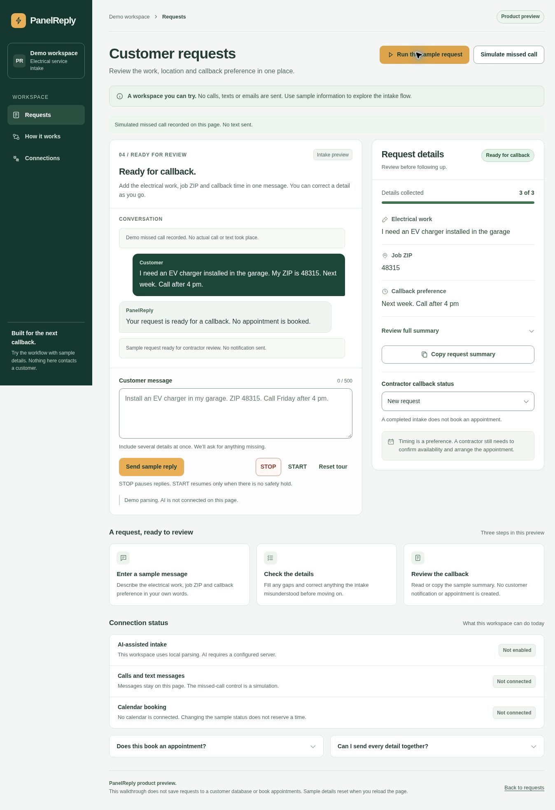

# Live AI activation

Recorded November 18, 2026, America/New_York.

The owner requested live AI activation. This document separates preparation, model verification and customer readiness. The static demo at https://panelreply-demo.onrender.com/ cannot run `server.cjs` and remains in local parsing mode.

## Current evidence

| Check | Status | Evidence |
| --- | --- | --- |
| Offline controller, parser and server tests | PASS | 99 tests, zero failures or skips |
| Generated page and CSP integrity | PASS | `node scripts/build-demo.cjs --check` |
| New sample-button browser regression | PASS | Real Chromium with a fake provider verified code preservation and explicit reset |
| Full application revision CI | PASS | 153 checks: 103 Node/HTTP/live GET and 50 Chromium, zero failures or skips |
| Node web-service deployment | PASS | Render deployment `dep-dbv6em8u01pc73cv87bg` is live from merge commit `01351baadd8061aa9df6c0712dc0d3f6be3bb082` |
| Deployed health route and sample intake | PASS | Browser showed healthy configuration, AI disabled, and the sample request collected all three fields |
| Secure OpenAI credential | BLOCKED | OpenAI Developers is installed; secure key setup remains to be completed |
| Available API credits or spending allowance | BLOCKED | Not yet verified or approved |
| Live model accuracy and failure handling | NOT TESTED | No real API requests made |
| Customer calls, SMS and calendar booking | NOT IMPLEMENTED | The app collects sample callback preferences only |

Passing fixture-based tests does not establish model availability, authentication, provider connectivity or live extraction accuracy. `/health` reports whether configuration passes validation. Its `aiEnabled` value is not proof that OpenAI accepted a request.

## Deployed preparation

- Service: `srv-dbv6do6tlv9c73fuvar0`, named `panelreply-ai`.
- Website: https://panelreply-ai.onrender.com/.
- Render dashboard: https://dashboard.render.com/web/srv-dbv6do6tlv9c73fuvar0.
- Deployment became live on November 18, 2026 at 10:05 PM America/New_York.
- Tested source: `d524ed8f2d07fe09a743f472c50f99a3ac20522f` in [PR #3](https://github.com/panelreply-business/panelreply-demo/pull/3).
- Deployed merge: `01351baadd8061aa9df6c0712dc0d3f6be3bb082`. It has the same tree, `5fabd09b574964416b886e52a9221a5834986e82`, as the tested source.
- Verification: [GitHub Actions run 44448007795](https://github.com/panelreply-business/panelreply-demo/actions/runs/44448007795), job `135304773115`.
- `/health` returned `{"ok":true,"aiEnabled":false,"bookingEnabled":false}`.
- The deployed browser sample produced job `I need an EV charger installed in the garage`, ZIP `48315`, timing `Next week. Call after 4 pm`, and `3 of 3` confirmed fields. The app showed that no appointment was booked and no notification was sent.
- The page body retained `data-ai-enabled="false"` and showed the local-parsing label. This is deployment readiness evidence, not a live model pass.

## Changes needed before activation

The sample-request button previously called reset and discarded the entered AI access code. It then used local parsing even when a configured AI server and a code were available. The controller now retains the code when starting a sample. Explicit `Reset tour` still clears it. A unit regression failed before this correction and passes afterward. A matching browser regression covers both actions.

Provider requests now set `service_tier: 'default'` so project defaults do not silently select another processing tier. The optional `OPENAI_REASONING_EFFORT` accepts supported enum values. Empty or omitted settings do not send a reasoning object, preserving compatibility with other selected models. Invalid provided values disable AI before a provider call.

The proposed extraction model is `gpt-6-luna` with reasoning effort `none`. Official model documentation lists Responses and structured-output support. Actual availability in this account remains unverified.

## Render web-service configuration

Use the existing Render workspace and repository. Keep automatic deployment disabled until each release passes its checks.

| Setting | Value |
| --- | --- |
| Repository | `https://github.com/panelreply-business/panelreply-demo` |
| Branch | `main` after the activation changes pass CI |
| Runtime | Node |
| Plan | Free |
| Region | Ohio |
| Build command | `node scripts/build-demo.cjs --check` |
| Start command | `node server.cjs` |
| Node version | `NODE_VERSION=22` |
| Environment | `NODE_ENV=production` |
| Application health route | `GET /health` |

Initial deployment must keep `AI_DEMO_ENABLED=false` and `AI_MAX_REQUESTS_PER_PROCESS=0`, with no API key. Set `PUBLIC_ORIGIN` to the exact HTTPS origin returned by Render, without a trailing slash. The service serves both the website and `/api/intake` on that origin. The static demo URL does not acquire a working AI endpoint merely because another service exists.

The free service can spin down after 15 minutes of inactivity. Its next request can take about a minute to wake it. Included instance hours, bandwidth and build usage still have platform limits. This is a controlled demo host, not an availability commitment for customer operations.

## Secure activation sequence

1. Verify the account has usable API credits or obtain the owner's specific spending allowance. ChatGPT subscription status alone is not evidence of an available API balance.
2. Use the OpenAI Developers secure credential flow when available, or have the owner place the key directly in the service's secret environment settings. Never place an API key in chat, source code, public documentation or the browser's demo-code field.
3. Set `OPENAI_API_KEY`, `OPENAI_MODEL=gpt-6-luna` and `OPENAI_REASONING_EFFORT=none` in the server environment.
4. Generate a random demo access code of at least 32 characters and set `DEMO_ACCESS_TOKEN`. This is a shared test gate, not customer authentication. Share it only with authorized testers through an approved private route.
5. Confirm `PUBLIC_ORIGIN` exactly matches the service URL. For an approved controlled test, use a small `AI_MAX_REQUESTS_PER_PROCESS` such as 25, then set `AI_DEMO_ENABLED=true` and deploy.
6. Wait for the deployment to become live, then verify the deployed commit and `GET /health`.
7. Run a small set of synthetic messages through the actual website. Record that the browser shows `AI extracted these details`, the fields match the supplied information and no local fallback occurred. Confirm bundled details, ZIP corrections, timing changes and an ambiguous request. Known STOP and hazard cases must continue to bypass the provider.
8. Record the actual results and request usage. Keep scheduled audits on fake-provider tests and read-only health checks unless the owner authorizes recurring API spend.

The process request cap resets on restart, spindown and redeploy, and applies independently to each instance. It is not a durable dollar limit. Failed provider attempts count against the cap, and the app does not automatically retry them. A disconnected browser or aborted request does not establish that an API attempt was free.

## Release gate

Live AI remains BLOCKED until credentials and spending conditions are satisfied and a provider-backed browser test passes. Do not mark it resolved from fixture tests or a configuration-only health response.

Customer launch remains NO-GO. Calendar booking, real calls/SMS, customer authentication, durable customer records, consent/suppression and production budget controls are not implemented.

## References

- [OpenAI model capabilities and supported reasoning efforts](https://developers.openai.com/api/docs/models/gpt-6-luna.md)
- [OpenAI Responses request parameters](https://developers.openai.com/api/reference/resources/responses/methods/create.md)
- [OpenAI structured outputs](https://developers.openai.com/api/docs/guides/structured-outputs.md)
- [ChatGPT API-credit eligibility and activation](https://developers.openai.com/api/docs/guides/chatgpt-api-credits.md)
- [Render free-service behavior and limits](https://render.com/docs/free.md)
- [Render Node version configuration](https://render.com/docs/node-version.md)
