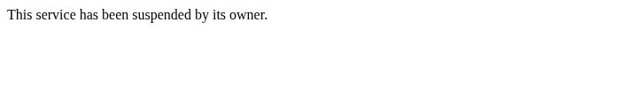

# Public demos intentionally offline

Recorded November 18, 2026, America/New_York.

The owner explicitly approved taking both public PanelReply demos offline while development continues. Both services were suspended through their Render Dashboard controls. No service, code, environment variable, deploy history or repository was deleted.

## Verified service state

| Demo | Render service | State | Suspension time |
| --- | --- | --- | --- |
| `https://panelreply-ai.onrender.com/` | `srv-dbv6do6tlv9c73fuvar0` | PASS — `suspended`, suspender `user` | November 18, 10:48:13 PM America/New_York |
| `https://panelreply-demo.onrender.com/` | `srv-dbu5o8tckfvc73b6fb4g` | PASS — `suspended`, suspender `user` | November 18, 10:49:28 PM America/New_York |

Render's connected service reads independently confirmed both states and `autoDeploy: no`. Both public roots were then loaded through browser controls. Each had the page title `Service Suspended` and displayed `This service has been suspended by its owner.` Neither served the PanelReply interface in those checks.

[Static demo suspension response](evidence/panelreply-demo-suspended-2026-11-18.jpg)

## Operating instruction

Keep both demos offline until the owner explicitly approves reopening them. Do not resume a service, trigger a deploy, republish either URL or create a replacement public preview as an outage correction. The service configurations and GitHub code are retained for development.

Automation `Automation_54cd897881e881918a23443ca2ccd8ce` keeps its existing schedule and enabled state. Its updated prompt continues repository/CI review, offline tests with fake providers and read-only Render inspection. It treats intentional public unavailability as expected, and live application behavior as BLOCKED.

## Test reporting

The last published application release passed 209 checks before shutdown, as recorded in [the question-answer release report](QUESTION_ANSWERS.md). That historical result does not make the public app available now.

During offline mode, distinguish these results:

- PASS: evidence that both services remain intentionally suspended and their URLs do not serve the app.
- PASS or FAIL: actual offline code, HTTP fake-provider and local Chromium test results.
- BLOCKED: checks requiring the public PanelReply app to be running.
- NOT IMPLEMENTED or BLOCKED: existing AI, booking and customer-integration gaps retain their recorded status.

The change does not authorize API usage, spending, customer contact, new accounts, security permission changes or production activation. Repository visibility was not changed.

## CI behavior during suspension

The workflow sets `PANELREPLY_EXPECT_PUBLIC_OFFLINE=true` for the Node test step. It retains the three public-app checks but marks them skipped with the reason `BLOCKED: public demos intentionally offline`. Two separate checks require HTTP 503 and Render's exact owner-suspension message from the demo roots, reject PanelReply markup, and fail on redirects, timeouts or connection errors. These checks verify the shutdown condition rather than claiming to test an unavailable app.

The existing controller, parser, saved-answer, HTTP fake-provider and Chromium suites still run. No service deployment is part of this CI-only change.
