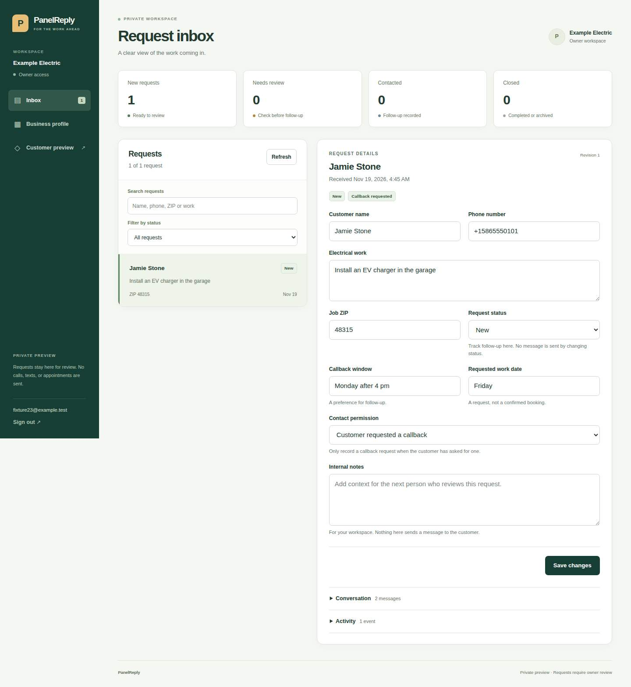

# Private workspace verification

Verified November 18, 2026, America/New_York. This record covers the standalone local contractor workspace. Both public Render demos remain suspended. No deployment, real customer account, provider request, call, SMS or customer contact was part of this change.

## Result

313 checks PASS, zero FAIL. Three public application checks remain BLOCKED because both public services are intentionally offline. Those three checks appear as explicit skips in Node's report and are not counted as passes.

- Application source: `e086c8a227737b5198cda1f6196eb29ba57d07c9`.
- Candidate tree: `7647cd9b849404a242f0c1d88120957c9ef1d756`.
- [PR6](https://github.com/panelreply-business/panelreply-demo/pull/6).
- [Full passing CI run 44460315464](https://github.com/panelreply-business/panelreply-demo/actions/runs/44460315464).
- Node.js 22.23.4 and Chromium 151.0.7922.34.
- The following documentation and screenshot commit does not change application or test behavior. Review PR6 and its latest checks for the final merge revision.

The full CI run completed at 11:45 PM on November 18 in America/New_York. The CI browser uses UTC, so its synthetic record screenshots show November19. This is the same verification window.

| Suite | PASS | FAIL | BLOCKED |
| --- | ---: | ---: | ---: |
| Node logic, storage, authentication, real HTTP and safe public GET guards | 217 | 0 | 3 |
| Existing basic browser checks | 11 | 0 | 0 |
| Existing intake, saved questions and fake-provider browser checks | 42 | 0 | 0 |
| Existing layout, keyboard, clipboard and accessibility regressions | 12 | 0 | 0 |
| New private workspace browser scenarios | 31 | 0 | 0 |
| Total | 313 | 0 | 3 |

Before CI, a combined offline run passed 208 tests with zero failures or skips. CI added actual HTTP listeners, Chromium, persistence through process restart and safe external suspension guards. Local HTTP/browser execution was not available in the authoring environment, so those results come from the linked CI run.

## Reproduced defects and verified fixes

| Priority | Defect and reproduction | Correction and evidence |
| --- | --- | --- |
| Medium | Send a complete request, then `Actually the job ZIP is 48084`. The new field splitter could replace the job with part of the label. | Keep ZIP labels intact. Regression preserves the job, callback and work date while changing ZIP. PASS in unit and full CI. |
| Medium | Ask `Could you contact me at 586-555-0101 tomorrow?`. The preview could miss the phone and put it into the callback field. | Recognize explicit polite contact clauses. With-time and without-time regression tests PASS. |
| Medium | Opt out a known phone after an earlier request was saved as New. Effective contact permission changed but the earlier request could still appear ready. | In the same transaction, move matching New requests to Needs review, increment versions and add audit metadata. Persistence and stale-write tests PASS. |
| Medium | A valid long transcript containing multibyte or escaped Unicode could exceed the old 64 KiB HTTP limit before reaching the documented field limits. | Increase the bounded body cap to 192 KiB. A fixture at every supported lead-field limit is accepted. Actual over-limit input still fails. PASS. |
| Medium | Refresh an open inbox request while entering notes during the pending response. The arriving response could replace unsaved edits. | Freeze editing during refresh and retain the dirty-state guard. Delayed-response browser regression PASS. |
| Medium | Hit the conversation limit with an unsent message. The textarea could become disabled while Save required that message to be cleared. | Keep the textarea editable at the limit while Send stays disabled. Browser test clears the unsent text and saves the previous transcript once. PASS. |
| Medium | Edit a request without callback permission or with a stored opt-out and select New or Contacted. | Reject unsupported status transitions. UI options follow the same restrictions. Backend and browser regressions PASS. |

No critical or high defect remained confirmed in the reviewed scope after verification. This is scoped evidence, not proof that all possible defects are absent.

## Browser coverage

The new suite starts the actual Node server and SQLite store. Each test receives a separate synthetic business and owner. The browser rejects external destinations and any call to the optional AI adapter.

Its 31 scenarios cover:

- Sign-in, generic rejected credentials, sign-out, expired sessions and denied anonymous pages/API access.
- Cross-business list/read/write isolation, including direct guessed-record requests.
- Approved business answers, unapproved facts staying unknown and profile persistence.
- Bundled name, phone, job, ZIP and two separate timing fields.
- Question-only messages preserving reviewed fields and ambiguous timing requiring explicit review.
- Saved record and transcript persistence across navigation, reload and server restart.
- Search, status filters, manual notes/status updates and revision/activity records.
- Invalid contact fields and missing information failing without false save confirmation.
- Lost save responses, server failures, duplicate submission prevention and same-key retry recovery.
- Stale lead/profile writes preserving local edits and requiring review before reload.
- STOP stored before lead creation, persistent suppression after START/reset, and contact restrictions.
- Safety holds surviving edits and rejecting ordinary status transitions.
- Customer markup rendered as text, with no executed script.
- Keyboard navigation, 360-pixel mobile layout and desktop rendering.
- Refresh while a response is pending, navigation guards and conversation-limit recovery.
- Appointment questions answered without claiming a booking or creating an appointment.

## Visual review

Both images below came from the passing browser run and were inspected. They contain synthetic test data only. Labels, field values, buttons and navigation remain visible without horizontal overflow at the checked sizes.

[Desktop inbox](evidence/private-inbox-desktop.jpg) · [Mobile customer preview](evidence/private-customer-preview-mobile.jpg)

## Render state

Read-only Render checks confirmed:

| Service | State | Automatic deployment | PR previews |
| --- | --- | --- | --- |
| `srv-dbv6do6tlv9c73fuvar0`, panelreply-ai | Suspended by user | Off | Off |
| `srv-dbu5o8tckfvc73b6fb4g`, panelreply-demo | Suspended by user | Off | Off |

Both belong to workspace `tea-dbu4qmrm8hqs73e4facg`. Their start/build settings still serve the previous demo surfaces. The private workspace is not deployed. The two CI public GET guards independently confirmed the 503 owner-suspended response and absence of application markup.

## Remaining gates

| Area | Status | Meaning |
| --- | --- | --- |
| Private local inbox, authentication, saved records and approved answers | PASS | Verified in the source and real CI server/browser flows above. |
| Local private review | GO | An operator can set up an owner and run the documented loopback server. No real owner was provisioned during this work. |
| Hosted private access | NOT IMPLEMENTED | No private hosted workspace was created or exposed. |
| Public application behavior | BLOCKED | Both services intentionally offline. |
| Live AI | BLOCKED | Secure key choice and approved use remain pending. No real provider-backed test has passed. |
| Free-form model-generated answers | NOT IMPLEMENTED | Preview answers use saved facts and deterministic recognition. |
| Calendar booking, live calls/SMS and notifications | NOT IMPLEMENTED | No appointments or messages are created. |
| Production backup/restore, account recovery, retention/export/deletion and monitoring | NOT IMPLEMENTED | Required before real customer operation. SQLite files are not encrypted by this application. |
| Sustained load, recovery objectives and all-device accessibility | NOT TESTED | The current checks do not establish production capacity, recovery guarantees or complete accessibility conformance. |
| Customer pilot | NO-GO | Hosting, recovery and approved integrations still need verification. |

Source setup and implementation limits are documented in [Private workspace](PRIVATE_WORKSPACE.md). The recurring audit must include this app and preserve the instruction to keep both public demos offline.
